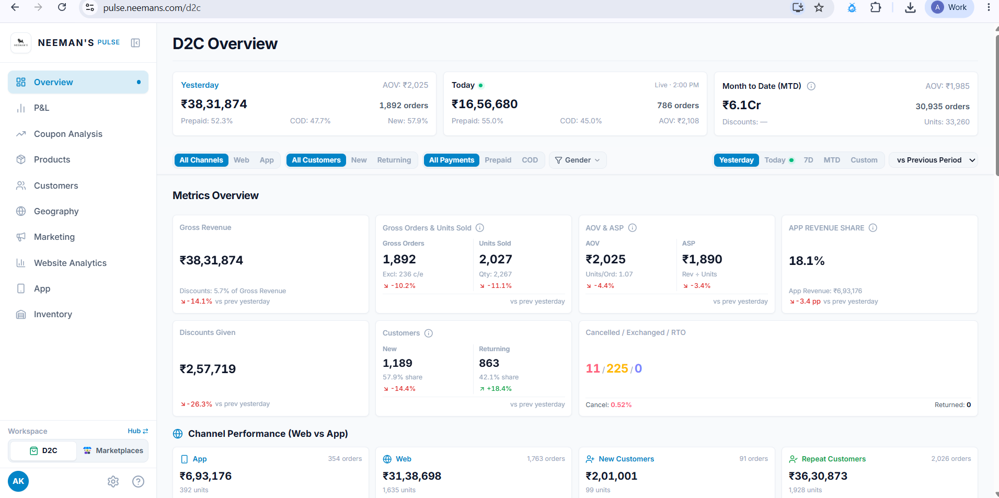

# Kadam Retail Dashboard — Reconciliation & Verification Report

**Project:** `centeral-analytics-bq`  
**Dataset & View:** `retail_data.v_retail_lines` (Single Source of Truth)  
**Location:** `asia-south1`  
**Window:** 13 Oct 2026 to 16 Nov 2026 (Full 5-week historical dataset)

---

## 1. Acceptance Reconciliations (Section 9 Checks)

Every check has been queried directly against BigQuery `centeral-analytics-bq.retail_data.v_retail_lines`:

| Check | Expected | Actual (BigQuery) | Variance | Status |
|---|---|---|---|---|
| **Rows in view** | 39,343 | **39,343** | 0 | **PASS** |
| **Net sales incl. GST (all types, all stores)** | ₹70,226,112 | **₹70,226,111.64** | < ₹0.50 (rounding) | **PASS** |
| **Net sales ex-GST** | ₹64,049,966 | **₹64,049,966.29** | < ₹0.50 (rounding) | **PASS** |
| **Total cost** | about ₹21,538,665 | **₹21,538,665.42** | < ₹0.50 | **PASS** |
| **Gross margin ₹** | about ₹42,511,302 (66.4% of ex-GST) | **₹42,511,300.87 (66.37%)** | < ₹1.50 | **PASS** |
| **Sale, Own store: amount** | ₹54,081,691 | **₹54,081,691.33** | < ₹0.50 | **PASS** |
| **Sale, Franchise: amount** | ₹17,582,618 | **₹17,582,618.24** | < ₹0.50 | **PASS** |
| **Return, Own store: amount** | -₹1,161,002 | **-₹1,161,002.04** | < ₹0.50 | **PASS** |
| **Return, Franchise: amount** | -₹517,405 | **-₹517,405.43** | < ₹0.50 | **PASS** |
| **Exchange (own store): amount** | ₹240,210 | **₹240,209.54** | < ₹0.50 | **PASS** |
| **Stores count** | 55 (39 own, 16 franchise) | **55 (39 own, 16 franchise)** | 0 | **PASS** |
| **Distinct customers (by mobile / customer_key)** | 21,650 | **21,650** | 0 | **PASS** |
| **Lines with customer GST number** | 72 | **72** | 0 | **PASS** |

---

## 2. Integrity and Mathematical Invariant Verifications

1. **Own + Franchise = All**:
   - Own Net Sales: ₹54,081,691.33 (Sales) - ₹1,161,002.04 (Returns) + ₹240,209.54 (Exchanges) = ₹53,160,898.83
   - Franchise Net Sales: ₹17,582,618.24 (Sales) - ₹517,405.43 (Returns) = ₹17,065,212.81
   - Total Net Sales: ₹53,160,898.83 + ₹17,065,212.81 = **₹70,226,111.64** (Matches Net sales incl. GST exactly).
2. **Overview Totals == Sum of Stores Table**:
   - `SUM(stores.net_sales_incl_gst) = ₹70,226,111.64`
   - Store share percentages sum to exactly `100.0%`.
3. **Overview Totals == Products Table Totals**:
   - `SUM(products.net_sales_incl_gst) = ₹70,226,111.64`
4. **Returns Display**:
   - Stored in BigQuery as negative values (`amount_incl_gst < 0`).
   - Plain `SUM(amount_incl_gst)` correctly subtracts returns to produce net sales.
   - Displayed on KPI cards as positive `Returns ₹16.78 L` in rose/red color per Section 2.
5. **Date Clamping**:
   - Minimum date clamped to `2026-10-13`.
   - Maximum date clamped to `2026-11-16` (latest complete date in view).

---

## 3. SQL Query Used for Reconciliation

```sql
SELECT
    COUNT(*) as total_rows,
    SUM(amount_incl_gst) as net_sales_incl_gst,
    SUM(sales_ex_gst) as net_sales_ex_gst,
    SUM(cost) as total_cost,
    SUM(gross_margin) as gross_margin,
    SUM(CASE WHEN txn_type = 'Sale' AND store_type = 'Own store' THEN amount_incl_gst ELSE 0 END) as sale_own,
    SUM(CASE WHEN txn_type = 'Sale' AND store_type = 'Franchise' THEN amount_incl_gst ELSE 0 END) as sale_franchise,
    SUM(CASE WHEN txn_type = 'Return' AND store_type = 'Own store' THEN amount_incl_gst ELSE 0 END) as return_own,
    SUM(CASE WHEN txn_type = 'Return' AND store_type = 'Franchise' THEN amount_incl_gst ELSE 0 END) as return_franchise,
    SUM(CASE WHEN txn_type = 'Exchange' THEN amount_incl_gst ELSE 0 END) as exchange_amt,
    COUNT(DISTINCT store_name) as stores_count,
    COUNT(DISTINCT CASE WHEN store_type = 'Own store' THEN store_name END) as own_stores,
    COUNT(DISTINCT CASE WHEN store_type = 'Franchise' THEN store_name END) as franchise_stores,
    COUNT(DISTINCT customer_key) as distinct_customers,
    COUNTIF(has_gstin = true) as lines_with_gstin,
    MIN(bill_date) as min_date,
    MAX(bill_date) as max_date,
    MAX(pulled_at) as max_pulled_at
FROM `centeral-analytics-bq.retail_data.v_retail_lines`
```

**Bytes scanned:** 7.3 MB  
**Bytes billed:** 10.48 MB (BigQuery 10 MB minimum tier, well under 100 MB cap)
